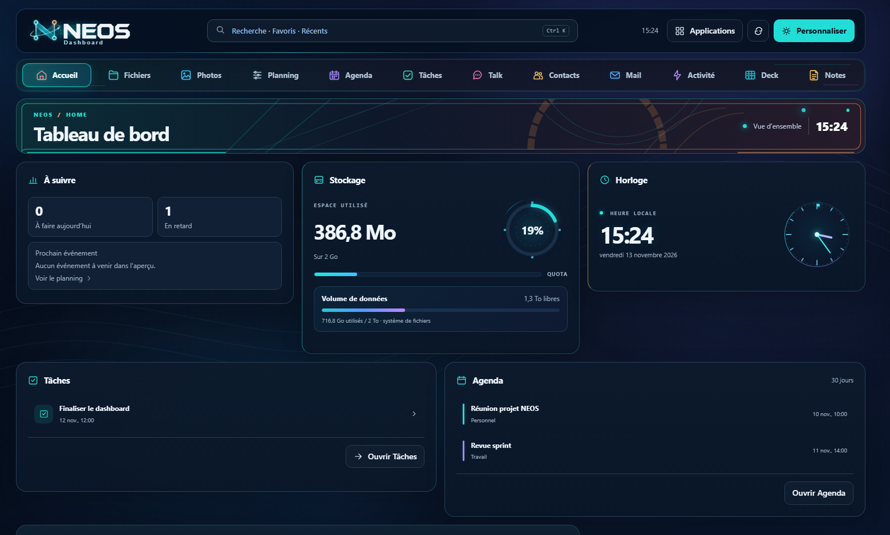

# Neos Launcher

**Un tableau de bord personnalisable pour Nextcloud 35.** Neos réunit les fichiers, les échéances et les applications du quotidien dans une interface intégrée à Nextcloud.

[Télécharger la dernière version](https://github.com/pxomaker-hue/Neos-Launcher/releases/latest) · [Anciennes versions](./archive/releases/) · [Installation](#installation) · [Démo](./docs/demo/) · [Signaler un problème](https://github.com/pxomaker-hue/Neos-Launcher/issues/new)

Pour lancer la démo avec des données fictives, télécharge le dépôt puis ouvre `docs/demo/index.html` dans ton navigateur.

## Fonctionnalités

- **Accueil personnalisable** avec widgets, raccourcis et « À suivre » pour les échéances et le prochain événement.
- **Fichiers** avec recherche par nom dans l’index Nextcloud, favoris et aperçu intégré.
- **Planning** pour consulter Agenda, Tâches et Deck au même endroit. Agenda affiche les occurrences des séries et prend en charge l’édition des événements simples.
- **Notes, Contacts, Activité, Talk et Mail** intégrés selon les applications activées sur ton serveur. Mail peut reprendre le texte et les pièces jointes d’un brouillon IMAP dans une copie.
- **Navigation compacte** avec des icônes sur écran réduit et des libellés accessibles au clavier et aux lecteurs d’écran.
- **Badges Mail et Talk** pour les messages non lus, y compris en mode icônes.

## Installation

Neos v0.7 cible **Nextcloud 35** et requiert **PHP 8.3 ou supérieur**. L’interface de l’application est en français. Un compte administrateur est nécessaire pour installer Neos. Les intégrations dépendent des applications activées et des droits du compte connecté.

1. Récupère le [ZIP installable](https://github.com/pxomaker-hue/Neos-Launcher/releases/latest).
2. Extrais le dossier `novadashboard` dans un répertoire d’applications configuré sur ton instance. Pour une mise à jour manuelle, sauvegarde d’abord l’installation existante.
3. Avec la commande `occ` de ton instance, active `novadashboard` si nécessaire (`occ app:enable novadashboard`). Suis les indications de Nextcloud si une mise à niveau est demandée.
4. Ouvre **Neos** dans la barre de navigation de Nextcloud.

Pour OpenMediaVault et le conteneur LinuxServer.io, le [guide PowerShell](./MODE-EMPLOI-DEPLOY-NEOS.md) détaille le déploiement et le retour arrière.

## Développement

- [`novadashboard/`](./novadashboard) contient le code et les ressources de l’application.
- [`archive/`](./archive) contient les maquettes, aperçus et [ZIP des versions précédentes](./archive/releases/), classés par série.
- [Publication Nextcloud](./docs/PUBLICATION-NEXTCLOUD.md) décrit la construction du paquet et les étapes de signature.
- [Checklist de validation](./novadashboard/PLAN-v0.7.md) couvre le déploiement et les intégrations sur une instance réelle. Les tests automatisés utilisent des données fictives.

Licence [AGPL-3.0-or-later](./LICENSE).
